# Анимации персонажа по этапам — задание для GPT

_Составлено 2026-11-18, версия проекта 0.2.x. Один этап = одна полная анимация. Схемы движения — `anim-stages/*.svg`._

Персонаж — маленькая фигурка в тёмно-синем капюшоне и плаще, кремовая маска с двумя чёрными овальными глазами,
голубые огненные рожки, бант, голубые языки пламени по краю плаща, тёмные ноги, сапожки с пряжками.
Подробно про формат и прошлые генерации — [FRAMES.md](FRAMES.md), [FRAMES-6.md](FRAMES-6.md),
[FRAMES-6-REVIEW.md](FRAMES-6-REVIEW.md). Проверка готового персонажа — [QA-CHECKLIST.md](QA-CHECKLIST.md).

**Цель — плавность.** Прошлые генерации давали 2–4 кадра на анимацию, и у соседних кадров «плыли» складки, огонь и
размер. Теперь каждая анимация — отдельный этап с 4–8 кадрами, схемой движения и проверкой.

---

## 1. Как идёт один этап

1. **Генерация (GPT, новый чат на каждый этап).** Приложить референсы этапа (§2) → вступление (§3) → кадры
   **по одному сообщению** в порядке: сначала крайние позы (обычно кадры 1 и середина), потом промежуточные. Каждый
   промпт — промпт кадра этапа + общий хвост (§3).
2. **Самопроверка (GPT, тот же или новый чат).** Собрать все кадры этапа в ряд и пройти чек-лист §4. Брак —
   перегенерировать (не править в том же сообщении). Записать `check.md` (§5).
3. **Сдача.** Папка `outputs/anim-stages/NN-<id>/`: PNG-кадры + `check.md`.
4. **Подключение (Claude).** Проверка, подгонка (масштаб, опора), WebP, частота кадров в коде, проверка вживую.

Этапы независимы: можно идти в любом порядке, но **Часть I — первой** (эти позы видны всё время).

---

## 2. Что прикладывать

- Всегда: `character-reference.png` и `stand.png` из `C:\Users\Alast\Documents\Codex\2026-11-16\x20-6\outputs\character-poses\`.
- Плюс референсы этапа (ссылки в каждом этапе ведут в пакет `ui/public/characters/default/` — это текущие кадры,
  их можно приложить как есть).
- Плюс **схему движения этапа** (`anim-stages/NN-<id>.svg`, можно скриншотом): GPT должен видеть, что куда
  движется. На схеме: фигура-силуэт (не образец рисунка, а положение частей), пунктир — пол, серые линии — опоры
  (край окна, стена, верх экрана); стрелки по цветам частей, номер у начала стрелки; пунктирный круг — часть
  **неподвижна**; внизу — полоска кадров и тип цикла.

Цвета стрелок: фиолетовый — голова/капюшон, синий — руки, зелёный — ноги, оранжевый — плащ/подол,
голубой — огонь рожек, серый — тело/вес, красный — предмет или эффект кода.

---

## 3. Вступление и общий хвост

Вступление (первое сообщение чата, с референсами):
```
The attached images are the exact reference for one character: a small hooded figure with a dark-blue hood
and cloak, a cream mask with two black oval eyes, blue flame horns, blue flame tongues along the cloak hem,
a bow, dark legs and small boots with buckles. The attached diagram shows how the body parts move in this
animation (arrows, numbered). We will draw ONE animation frame by frame. Keep the design, colors, line style,
shading, proportions and SCALE identical in every frame. Do not reply with text, only with images.
```

Общий хвост (в конце **каждого** промпта кадра):
```
Clean cut-out on a fully transparent background (alpha 0): no halo, no smoke, no shadow, no outline, no
vignette, no background color. The blue flames keep their own light but do not spill onto the background.
No letters, no "z", no text, no symbols. The cream mask is about 184 px tall on a 1024x1536 canvas; the
character stays inside the canvas with margins. Keep the exact same framing as the previous frame of this
animation: the anchor point does not move, only the parts named in this frame move. PNG, 1024x1536, vertical.
```

**Как получить плавность (важно):**
- Сначала нарисовать **крайние позы**, затем просить промежуточные: «draw the in-between frame exactly halfway
  between frame 1 and frame 3».
- Двигать **мало**: соседние кадры отличаются на 10–30 px в движущихся частях. Большой скачок — разбить на два кадра.
- Огонь рожек и пламя плаща — **одной формы во всех кадрах**, только наклоняются. Если генератор каждый раз рисует
  огонь по-новому, это главный источник «дрожи».
- Складки плаща — те же, только смещаются по стрелкам.

---

## 4. Чек-лист этапа (самопроверка GPT)

| # | Проверка | Как |
|---|---|---|
| 1 | Формат | PNG RGBA, 1024×1536, углы прозрачные |
| 2 | Чистота | нет ореола, тени, обводки, букв, фона |
| 3 | Масштаб | маска 175–200 px во **всех** кадрах; разброс внутри этапа не больше 5 % |
| 4 | Опора | точка опоры этапа на одном месте (ступни на одной линии, кулаки на кромке и т. д.) |
| 5 | Направление | смотрит вправо (кроме оговорённых случаев) |
| 6 | Движение | совпадает со стрелками схемы; неподвижные части (пунктирный круг) не двигаются |
| 7 | Плавность | ряд кадров подряд — без скачков формы огня, складок, лица; соседние кадры близки |
| 8 | Цикл | у кольца последний кадр плавно переходит в первый; у «туда-обратно» — крайние кадры спокойные |
| 9 | Предметы | только те, что указаны в этапе; надписей нет; предметы кода (значок, иконки, кольца) **не** рисовать |
| 10 | Дизайн | капюшон, маска, глаза, рожки, бант, сапоги — как на референсе |

---

## 5. Сдача этапа — `check.md`

```markdown
# Этап NN — <id>
Кадров: N. Перегенерировано: <какие и почему>.
| # | Проверка | ✓/✗ | Комментарий |
|---|---|---|---|
| 1 | Формат | ✓ | |
...
Сомнения: <что стоит посмотреть Claude>.
```

---

## 6. Этапы
| № | Анимация | id | Кадры | Цикл |
|---|---|---|---|---|
| 01 | Стоит, дышит | `stand` | 6 | туда-обратно |
| 02 | Идёт | `walk` | 8 | кольцо |
| 03 | Сидит на краю окна, болтает ногами | `sit_edge` | 6 | туда-обратно |
| 04 | Сидит на углу окна | `perch_corner` | 6 | туда-обратно |
| 05 | Сидит на полу в углу | `sit_corner` | 6 | туда-обратно |
| 06 | Облокотился о край окна | `lean_side` | 6 | туда-обратно |
| 07 | Держат мышью за капюшон | `held` | 6 | туда-обратно |
| 08 | Летит / падает | `float` | 6 | туда-обратно |
| 09 | Лезет по стене | `climb` | 6 | кольцо |
| 10 | Висит, держась за край | `hang_side` | 6 | туда-обратно |
| 11 | Лежит | `laydown` | 4 | туда-обратно |
| 12 | Спит | `sleep` | 4 | туда-обратно |
| 13 | Машет рукой | `wave` | 6 | туда-обратно |
| 14 | Жмурится, когда гладят | `purr` | 4 | туда-обратно |
| 15 | Тянется к курсору | `reach` | 4 | туда-обратно |
| 16 | Кружится голова | `dizzy` | 4 | кольцо |
| 17 | Зевает, потягивается | `yawn` | 4 | один раз |
| 18 | Танцует | `dance` | 8 | кольцо |
| 19 | Тычет пальцем в кнопку | `poke` | 4 | туда-обратно |
| 20 | Выглядывает из-за края | `peek` | 4 | туда-обратно |
| 21 | Смотрит фильм с попкорном | `watch` | 6 | туда-обратно |
| 22 | Поёт | `sing` | 6 | туда-обратно |
| 23 | Сидит на музыкальном ящике | `jukebox` | 6 | туда-обратно |
| 24 | Бежит за жуком | `chase` | 8 | кольцо |
| 25 | Тащит коробку на спине | `carry_box` | 8 | кольцо |
| 26 | Сдувает ветром (Win+D) | `blown` | 6 | кольцо |
| 27 | Стучит изнутри по стеклу | `knock` | 6 | туда-обратно |
| 28 | Ставит штамп «Сохранено!» | `stamp` | 6 | один раз |
| 29 | Ловит бумажку | `hug_paper` | 5 | один раз |
| 30 | Пугается вспышки скриншота | `flinch` | 5 | один раз |
| 31 | Спотыкается и падает | `trip` | 6 | один раз |
| 32 | Вертит находку | `inspect` | 6 | один раз |
| 33 | Прячет в карман | `pocket` | 4 | один раз |
| 34 | Кладёт обратно | `put_back` | 4 | один раз |
| 35 | Выбрасывает и отряхивает руки | `throw` | 6 | один раз |
| 36 | Читает книжку | `read` | 6 | туда-обратно |
| 37 | Рисует | `draw` | 6 | туда-обратно |
| 38 | Жонглирует | `juggle` | 6 | кольцо |
| 39 | Строит | `build` | 6 | один раз |
| 40 | Прилепляет записку | `note_put` | 4 | один раз |
| 41 | Забирает записку | `note_take` | 4 | один раз |

## Часть I. Основа — видна почти всё время

### Этап 01. Стоит, дышит — `stand`

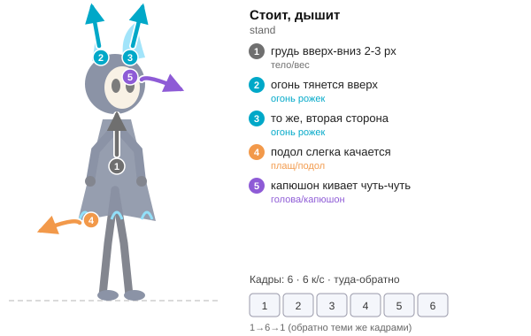

- **Что:** Спокойное дыхание на месте: главная поза, видна чаще всего — должна быть самой плавной.
- **Кадры:** 6, 6 к/с, цикл — туда-обратно. Файлы: `stand_1.png` … `stand_6.png` + `stand.png` (копия самого типичного кадра).
- **Опора:** ступни (0,5; 0,97). **Референсы из пакета:** [`stand`](../../ui/public/characters/default/stand.webp), [`stand_1`](../../ui/public/characters/default/stand_1.webp), [`stand_blink`](../../ui/public/characters/default/stand_blink.webp) + `character-reference.png`.
- **Особо:** Двигается очень мало: ступни и маска стоят на месте до пикселя. Это самый частый кадр — любой «прыжок» размера здесь виден сразу.

**Фазы (идут в промпт кадра N):**
1. neutral pose exactly like stand.png
2. chest rises slightly, shoulders up 2-3 px, cloak hem lifts a little
3. top of breath: hood tilts very slightly up, flame horns stretch upward
4. chest falls back, cloak hem settles
5. slight weight shift to the back foot, hem sways to the left
6. back to neutral, ready to loop

**Движение частей (стрелки на схеме):**
- **1** (тело/вес): грудь вверх-вниз 2-3 px
- **2** (огонь рожек): огонь тянется вверх
- **3** (огонь рожек): то же, вторая сторона
- **4** (плащ/подол): подол слегка качается
- **5** (голова/капюшон): капюшон кивает чуть-чуть

**Промпт кадра N** (после вступления, к нему — общий хвост из §3):
```
Animation "stand", frame N of 6: <phase N from the list above>. Same character, same scale and
the same anchor (ступни) as the reference; facing RIGHT. Only the parts listed in the phase move;
everything else stays exactly in place.
```

### Этап 02. Идёт — `walk`

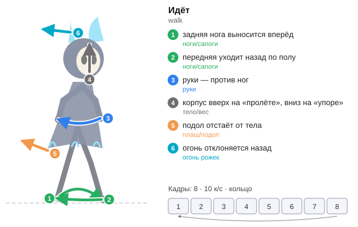

- **Что:** Цикл шага вправо: две ступни на полу по очереди, корпус чуть подпрыгивает.
- **Кадры:** 8, 10 к/с, цикл — кольцо. Файлы: `walk_1.png` … `walk_8.png` + `walk.png` (копия самого типичного кадра).
- **Опора:** ступни (0,5; 0,97). **Референсы из пакета:** [`walk`](../../ui/public/characters/default/walk.webp), [`walk_1`](../../ui/public/characters/default/walk_1.webp), [`walk_3`](../../ui/public/characters/default/walk_3.webp), [`walk_5`](../../ui/public/characters/default/walk_5.webp) + `character-reference.png`.
- **Особо:** Ступни скользят по полу назад с одной скоростью (персонаж «идёт на месте» — сдвигает код). Голова не качается в стороны.

**Фазы (идут в промпт кадра N):**
1. contact: right foot forward touching the floor heel first, left foot back, arms opposite
2. down: weight on the right foot, knees bend, body lowest, cloak hem swings back
3. passing: left leg passes the right, body rises, arms pass the body
4. up: body highest, left foot lifts forward, hood bobs up
5. contact: left foot forward heel first, right foot back (mirror of frame 1)
6. down: weight on the left foot, body lowest
7. passing: right leg passes the left
8. up: body highest, right foot lifts forward, ready to loop to frame 1

**Движение частей (стрелки на схеме):**
- **1** (ноги/сапоги): задняя нога выносится вперёд
- **2** (ноги/сапоги): передняя уходит назад по полу
- **3** (руки): руки — против ног
- **4** (тело/вес): корпус вверх на «пролёте», вниз на «упоре»
- **5** (плащ/подол): подол отстаёт от тела
- **6** (огонь рожек): огонь отклоняется назад

**Промпт кадра N** (после вступления, к нему — общий хвост из §3):
```
Animation "walk", frame N of 8: <phase N from the list above>. Same character, same scale and
the same anchor (ступни) as the reference; facing RIGHT. Only the parts listed in the phase move;
everything else stays exactly in place.
```

### Этап 03. Сидит на краю окна, болтает ногами — `sit_edge`

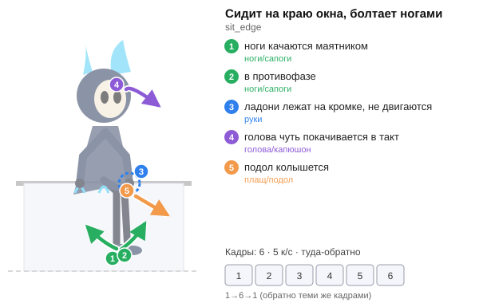

- **Что:** Сидит на верхней кромке окна, ноги свисают и неспешно покачиваются.
- **Кадры:** 6, 5 к/с, цикл — туда-обратно. Файлы: `sit_edge_1.png` … `sit_edge_6.png` + `sit_edge.png` (копия самого типичного кадра).
- **Опора:** сиденье (0,5; 0,62). **Референсы из пакета:** [`sit_edge`](../../ui/public/characters/default/sit_edge.webp), [`sit_edge_1`](../../ui/public/characters/default/sit_edge_1.webp), [`sit_edge_blink`](../../ui/public/characters/default/sit_edge_blink.webp) + `character-reference.png`.
- **Особо:** Линия сиденья (кромка окна) — ровная горизонталь на 0,62 высоты во всех кадрах; таз на ней не «ездит».

**Фазы (идут в промпт кадра N):**
1. sitting on the edge, both legs hanging straight down
2. right leg swings forward a little, left back
3. right leg at the front, left at the back, cloak hem shifts
4. legs pass each other
5. left leg forward, right back
6. back toward straight, ready to loop

**Движение частей (стрелки на схеме):**
- **1** (ноги/сапоги): ноги качаются маятником
- **2** (ноги/сапоги): в противофазе
- **3** (руки): ладони лежат на кромке, не двигаются
- **4** (голова/капюшон): голова чуть покачивается в такт
- **5** (плащ/подол): подол колышется

**Промпт кадра N** (после вступления, к нему — общий хвост из §3):
```
Animation "sit_edge", frame N of 6: <phase N from the list above>. Same character, same scale and
the same anchor (сиденье) as the reference; facing RIGHT. Only the parts listed in the phase move;
everything else stays exactly in place.
```

### Этап 04. Сидит на углу окна — `perch_corner`

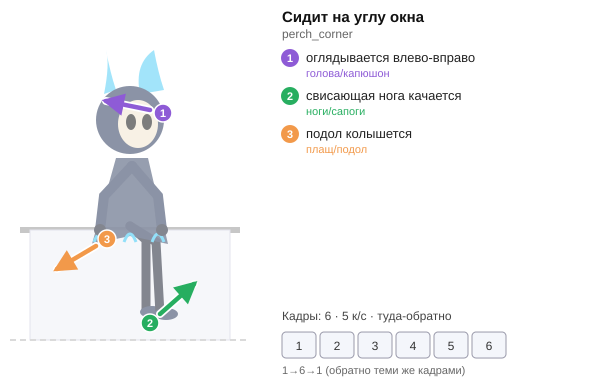

- **Что:** Сидит на углу, одна нога подогнута, другая свисает, оглядывается.
- **Кадры:** 6, 5 к/с, цикл — туда-обратно. Файлы: `perch_corner_1.png` … `perch_corner_6.png` + `perch_corner.png` (копия самого типичного кадра).
- **Опора:** сиденье (0,5; 0,62). **Референсы из пакета:** [`perch_corner`](../../ui/public/characters/default/perch_corner.webp), [`perch_corner_1`](../../ui/public/characters/default/perch_corner_1.webp) + `character-reference.png`.
- **Особо:** Опора — линия сиденья, как у sit_edge.

**Фазы (идут в промпт кадра N):**
1. perched on the corner, one leg tucked, one hanging
2. looks slightly to the left, tucked knee rises a bit
3. hanging leg swings forward
4. looks back to the right
5. hanging leg swings back
6. neutral, loop

**Движение частей (стрелки на схеме):**
- **1** (голова/капюшон): оглядывается влево-вправо
- **2** (ноги/сапоги): свисающая нога качается
- **3** (плащ/подол): подол колышется

**Промпт кадра N** (после вступления, к нему — общий хвост из §3):
```
Animation "perch_corner", frame N of 6: <phase N from the list above>. Same character, same scale and
the same anchor (сиденье) as the reference; facing RIGHT. Only the parts listed in the phase move;
everything else stays exactly in place.
```

### Этап 05. Сидит на полу в углу — `sit_corner`

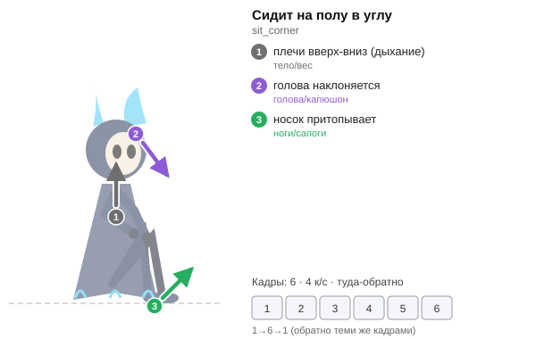

- **Что:** Сидит на полу, обняв колени, дышит.
- **Кадры:** 6, 4 к/с, цикл — туда-обратно. Файлы: `sit_corner_1.png` … `sit_corner_6.png` + `sit_corner.png` (копия самого типичного кадра).
- **Опора:** низ (0,5; 0,95). **Референсы из пакета:** [`sit_corner`](../../ui/public/characters/default/sit_corner.webp), [`sit_corner_1`](../../ui/public/characters/default/sit_corner_1.webp) + `character-reference.png`.

**Фазы (идут в промпт кадра N):**
1. sitting on the floor hugging the knees
2. breath in: shoulders up a little
3. head tilts slightly
4. breath out
5. toes tap once
6. neutral, loop

**Движение частей (стрелки на схеме):**
- **1** (тело/вес): плечи вверх-вниз (дыхание)
- **2** (голова/капюшон): голова наклоняется
- **3** (ноги/сапоги): носок притопывает

**Промпт кадра N** (после вступления, к нему — общий хвост из §3):
```
Animation "sit_corner", frame N of 6: <phase N from the list above>. Same character, same scale and
the same anchor (низ) as the reference; facing RIGHT. Only the parts listed in the phase move;
everything else stays exactly in place.
```

### Этап 06. Облокотился о край окна — `lean_side`

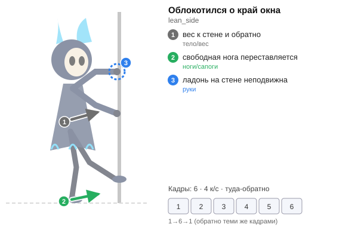

- **Что:** Стоит боком, опершись рукой о край окна справа.
- **Кадры:** 6, 4 к/с, цикл — туда-обратно. Файлы: `lean_side_1.png` … `lean_side_6.png` + `lean_side.png` (копия самого типичного кадра).
- **Опора:** ступни (0,5; 0,97). **Референсы из пакета:** [`lean_side`](../../ui/public/characters/default/lean_side.webp), [`lean_side_1`](../../ui/public/characters/default/lean_side_1.webp) + `character-reference.png`.
- **Особо:** Рука у стены не скользит.

**Фазы (идут в промпт кадра N):**
1. leaning on the wall with one hand
2. weight shifts toward the wall
3. free foot crosses behind
4. breath
5. weight shifts back
6. loop

**Движение частей (стрелки на схеме):**
- **1** (тело/вес): вес к стене и обратно
- **2** (ноги/сапоги): свободная нога переставляется
- **3** (руки): ладонь на стене неподвижна

**Промпт кадра N** (после вступления, к нему — общий хвост из §3):
```
Animation "lean_side", frame N of 6: <phase N from the list above>. Same character, same scale and
the same anchor (ступни) as the reference; facing RIGHT. Only the parts listed in the phase move;
everything else stays exactly in place.
```

### Этап 07. Держат мышью за капюшон — `held`

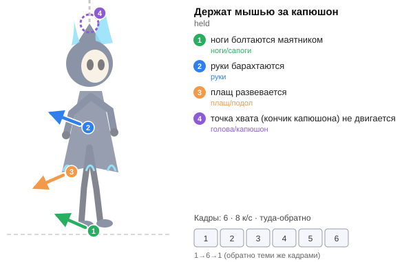

- **Что:** Висит за капюшон, болтает ногами и руками, как котёнок за шкирку.
- **Кадры:** 6, 8 к/с, цикл — туда-обратно. Файлы: `held_1.png` … `held_6.png` + `held.png` (копия самого типичного кадра).
- **Опора:** кончик капюшона (0,5; 0,06). **Референсы из пакета:** [`held`](../../ui/public/characters/default/held.webp), [`held_1`](../../ui/public/characters/default/held_1.webp), [`held_3`](../../ui/public/characters/default/held_3.webp) + `character-reference.png`.
- **Особо:** Кончик капюшона — неподвижная точка вверху по центру; всё остальное раскачивается вокруг неё.

**Фазы (идут в промпт кадра N):**
1. hanging by the hood tip, legs dangling
2. legs swing left, arms flail a little
3. body swings right, cloak flutters
4. legs kick
5. swing back left
6. loop

**Движение частей (стрелки на схеме):**
- **1** (ноги/сапоги): ноги болтаются маятником
- **2** (руки): руки барахтаются
- **3** (плащ/подол): плащ развевается
- **4** (голова/капюшон): точка хвата (кончик капюшона) не двигается

**Промпт кадра N** (после вступления, к нему — общий хвост из §3):
```
Animation "held", frame N of 6: <phase N from the list above>. Same character, same scale and
the same anchor (кончик капюшона) as the reference; facing RIGHT. Only the parts listed in the phase move;
everything else stays exactly in place.
```

### Этап 08. Летит / падает — `float`

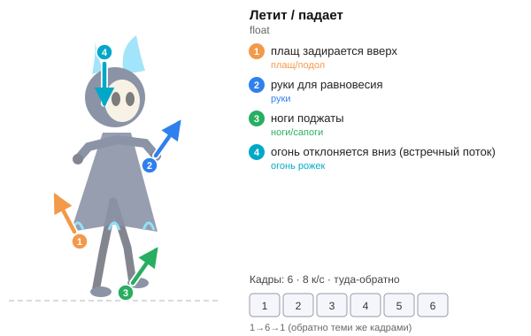

- **Что:** В воздухе: прыжок, падение, выход из портала.
- **Кадры:** 6, 8 к/с, цикл — туда-обратно. Файлы: `float_1.png` … `float_6.png` + `float.png` (копия самого типичного кадра).
- **Опора:** середина тела (0,5; 0,6). **Референсы из пакета:** [`float`](../../ui/public/characters/default/float.webp), [`float_1`](../../ui/public/characters/default/float_1.webp) + `character-reference.png`.

**Фазы (идут в промпт кадра N):**
1. airborne, arms out, legs bent
2. cloak billows up
3. arms rise
4. legs kick slightly
5. cloak settles
6. loop

**Движение частей (стрелки на схеме):**
- **1** (плащ/подол): плащ задирается вверх
- **2** (руки): руки для равновесия
- **3** (ноги/сапоги): ноги поджаты
- **4** (огонь рожек): огонь отклоняется вниз (встречный поток)

**Промпт кадра N** (после вступления, к нему — общий хвост из §3):
```
Animation "float", frame N of 6: <phase N from the list above>. Same character, same scale and
the same anchor (середина тела) as the reference; facing RIGHT. Only the parts listed in the phase move;
everything else stays exactly in place.
```

### Этап 09. Лезет по стене — `climb`

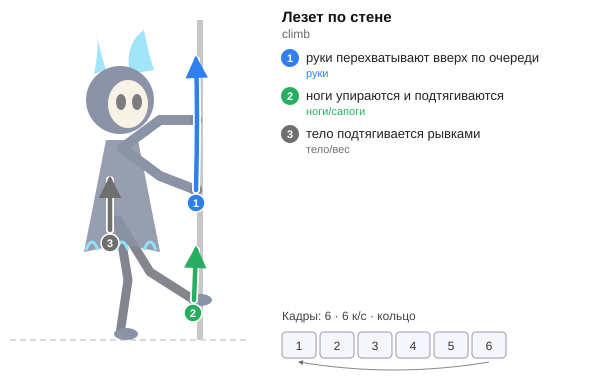

- **Что:** Карабкается по правому краю экрана вверх.
- **Кадры:** 6, 6 к/с, цикл — кольцо. Файлы: `climb_1.png` … `climb_6.png` + `climb.png` (копия самого типичного кадра).
- **Опора:** середина тела (0,5; 0,5). **Референсы из пакета:** [`climb`](../../ui/public/characters/default/climb.webp), [`climb_1`](../../ui/public/characters/default/climb_1.webp), [`climb_3`](../../ui/public/characters/default/climb_3.webp) + `character-reference.png`.
- **Особо:** Руки и ступни касаются одной вертикали (стены) справа.

**Фазы (идут в промпт кадра N):**
1. right hand up on the wall, left foot pushing
2. pull up, body rises
3. left hand reaches up
4. right foot steps up
5. pull up again
6. loop

**Движение частей (стрелки на схеме):**
- **1** (руки): руки перехватывают вверх по очереди
- **2** (ноги/сапоги): ноги упираются и подтягиваются
- **3** (тело/вес): тело подтягивается рывками

**Промпт кадра N** (после вступления, к нему — общий хвост из §3):
```
Animation "climb", frame N of 6: <phase N from the list above>. Same character, same scale and
the same anchor (середина тела) as the reference; facing RIGHT. Only the parts listed in the phase move;
everything else stays exactly in place.
```

### Этап 10. Висит, держась за край — `hang_side`

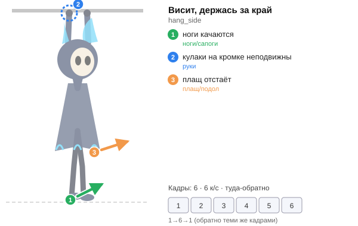

- **Что:** Висит на руках, ухватившись за верх экрана/окна.
- **Кадры:** 6, 6 к/с, цикл — туда-обратно. Файлы: `hang_side_1.png` … `hang_side_6.png` + `hang_side.png` (копия самого типичного кадра).
- **Опора:** кулаки (0,5; 0,04). **Референсы из пакета:** [`hang_side`](../../ui/public/characters/default/hang_side.webp), [`hang_side_1`](../../ui/public/characters/default/hang_side_1.webp) + `character-reference.png`.

**Фазы (идут в промпт кадра N):**
1. hanging by both hands
2. legs swing forward
3. swing back
4. one hand re-grips
5. legs kick
6. loop

**Движение частей (стрелки на схеме):**
- **1** (ноги/сапоги): ноги качаются
- **2** (руки): кулаки на кромке неподвижны
- **3** (плащ/подол): плащ отстаёт

**Промпт кадра N** (после вступления, к нему — общий хвост из §3):
```
Animation "hang_side", frame N of 6: <phase N from the list above>. Same character, same scale and
the same anchor (кулаки) as the reference; facing RIGHT. Only the parts listed in the phase move;
everything else stays exactly in place.
```

### Этап 11. Лежит — `laydown`

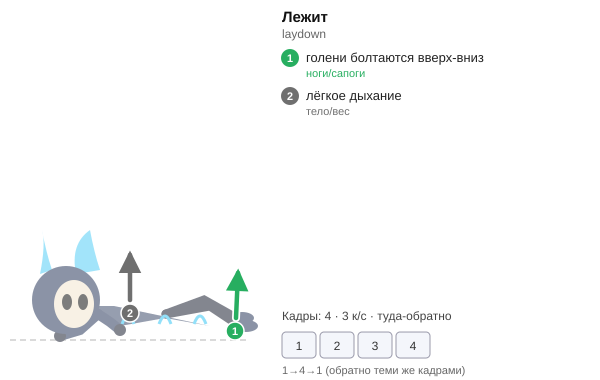

- **Что:** Лёг на живот, болтает ногами, подперев голову.
- **Кадры:** 4, 3 к/с, цикл — туда-обратно. Файлы: `laydown_1.png` … `laydown_4.png` + `laydown.png` (копия самого типичного кадра).
- **Опора:** тело на полу (0,5; 0,92). **Референсы из пакета:** [`laydown`](../../ui/public/characters/default/laydown.webp), [`laydown_1`](../../ui/public/characters/default/laydown_1.webp), [`laydown_blink`](../../ui/public/characters/default/laydown_blink.webp) + `character-reference.png`.
- **Особо:** Голова слева (как в имеющихся кадрах).

**Фазы (идут в промпт кадра N):**
1. lying, chin on hands
2. lower legs swing up
3. legs swing down
4. loop

**Движение частей (стрелки на схеме):**
- **1** (ноги/сапоги): голени болтаются вверх-вниз
- **2** (тело/вес): лёгкое дыхание

**Промпт кадра N** (после вступления, к нему — общий хвост из §3):
```
Animation "laydown", frame N of 4: <phase N from the list above>. Same character, same scale and
the same anchor (тело на полу) as the reference; facing RIGHT. Only the parts listed in the phase move;
everything else stays exactly in place.
```

### Этап 12. Спит — `sleep`

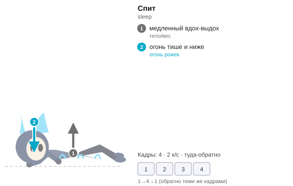

- **Что:** Спит, медленное глубокое дыхание.
- **Кадры:** 4, 2 к/с, цикл — туда-обратно. Файлы: `sleep_1.png` … `sleep_4.png` + `sleep.png` (копия самого типичного кадра).
- **Опора:** тело на полу (0,5; 0,92). **Референсы из пакета:** [`sleep`](../../ui/public/characters/default/sleep.webp), [`sleep_1`](../../ui/public/characters/default/sleep_1.webp) + `character-reference.png`.
- **Особо:** Никаких букв «z».

**Фазы (идут в промпт кадра N):**
1. asleep, eyes closed
2. slow breath in, body rises 3 px
3. top of breath, flames dim and calm
4. breath out, loop

**Движение частей (стрелки на схеме):**
- **1** (тело/вес): медленный вдох-выдох
- **2** (огонь рожек): огонь тише и ниже

**Промпт кадра N** (после вступления, к нему — общий хвост из §3):
```
Animation "sleep", frame N of 4: <phase N from the list above>. Same character, same scale and
the same anchor (тело на полу) as the reference; facing RIGHT. Only the parts listed in the phase move;
everything else stays exactly in place.
```

## Часть II. Эмоции и реакции

### Этап 13. Машет рукой — `wave`

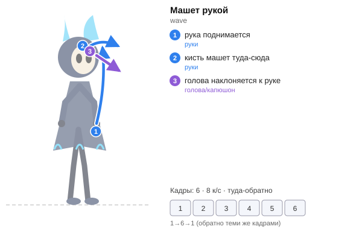

- **Что:** Приветствие: поднимает руку и машет.
- **Кадры:** 6, 8 к/с, цикл — туда-обратно. Файлы: `wave_1.png` … `wave_6.png` + `wave.png` (копия самого типичного кадра).
- **Опора:** ступни. **Референсы из пакета:** [`wave`](../../ui/public/characters/default/wave.webp), [`wave_1`](../../ui/public/characters/default/wave_1.webp), [`stand_to_wave_1`](../../ui/public/characters/default/stand_to_wave_1.webp) + `character-reference.png`.

**Фазы (идут в промпт кадра N):**
1. raises the right arm
2. hand fully up, palm open
3. wave to the right
4. wave to the left
5. wave to the right
6. lowering

**Движение частей (стрелки на схеме):**
- **1** (руки): рука поднимается
- **2** (руки): кисть машет туда-сюда
- **3** (голова/капюшон): голова наклоняется к руке

**Промпт кадра N** (после вступления, к нему — общий хвост из §3):
```
Animation "wave", frame N of 6: <phase N from the list above>. Same character, same scale and
the same anchor (ступни) as the reference; facing RIGHT. Only the parts listed in the phase move;
everything else stays exactly in place.
```

### Этап 14. Жмурится, когда гладят — `purr`

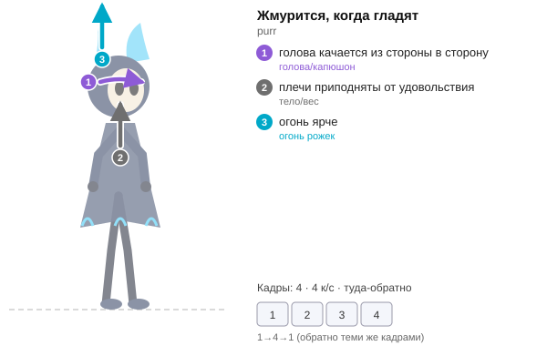

- **Что:** Гладят курсором: жмурится, румянец, покачивается.
- **Кадры:** 4, 4 к/с, цикл — туда-обратно. Файлы: `purr_1.png` … `purr_4.png` + `purr.png` (копия самого типичного кадра).
- **Опора:** ступни. **Референсы из пакета:** [`purr`](../../ui/public/characters/default/purr.webp), [`purr_1`](../../ui/public/characters/default/purr_1.webp), [`purr_2`](../../ui/public/characters/default/purr_2.webp), [`pet`](../../ui/public/characters/default/pet.webp) + `character-reference.png`.

**Фазы (идут в промпт кадра N):**
1. eyes closed in happy curves, blush, head tilted right
2. head sways to center
3. head tilted left, shoulders up
4. back to center

**Движение частей (стрелки на схеме):**
- **1** (голова/капюшон): голова качается из стороны в сторону
- **2** (тело/вес): плечи приподняты от удовольствия
- **3** (огонь рожек): огонь ярче

**Промпт кадра N** (после вступления, к нему — общий хвост из §3):
```
Animation "purr", frame N of 4: <phase N from the list above>. Same character, same scale and
the same anchor (ступни) as the reference; facing RIGHT. Only the parts listed in the phase move;
everything else stays exactly in place.
```

### Этап 15. Тянется к курсору — `reach`

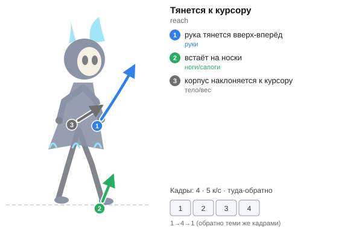

- **Что:** Как кошка к лазерной указке: тянется лапкой к курсору.
- **Кадры:** 4, 5 к/с, цикл — туда-обратно. Файлы: `reach_1.png` … `reach_4.png` + `reach.png` (копия самого типичного кадра).
- **Опора:** ступни. **Референсы из пакета:** [`reach`](../../ui/public/characters/default/reach.webp), [`reach_1`](../../ui/public/characters/default/reach_1.webp), [`reach_2`](../../ui/public/characters/default/reach_2.webp) + `character-reference.png`.

**Фазы (идут в промпт кадра N):**
1. leans forward, eyes on the cursor
2. reaches out on tiptoes
3. quick paw swipe
4. pulls the hand back a little

**Движение частей (стрелки на схеме):**
- **1** (руки): рука тянется вверх-вперёд
- **2** (ноги/сапоги): встаёт на носки
- **3** (тело/вес): корпус наклоняется к курсору

**Промпт кадра N** (после вступления, к нему — общий хвост из §3):
```
Animation "reach", frame N of 4: <phase N from the list above>. Same character, same scale and
the same anchor (ступни) as the reference; facing RIGHT. Only the parts listed in the phase move;
everything else stays exactly in place.
```

### Этап 16. Кружится голова — `dizzy`

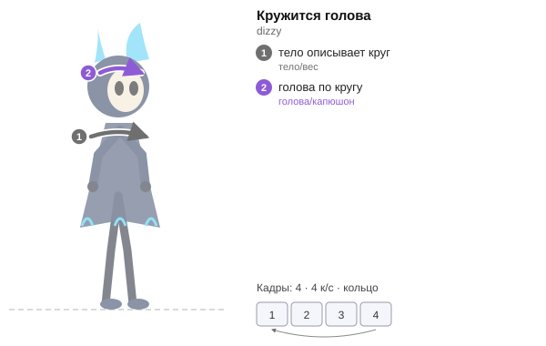

- **Что:** После тряски: шатается, глаза-спиральки.
- **Кадры:** 4, 4 к/с, цикл — кольцо. Файлы: `dizzy_1.png` … `dizzy_4.png` + `dizzy.png` (копия самого типичного кадра).
- **Опора:** ступни. **Референсы из пакета:** [`dizzy`](../../ui/public/characters/default/dizzy.webp), [`dizzy_1`](../../ui/public/characters/default/dizzy_1.webp) + `character-reference.png`.
- **Особо:** Ступни на месте.

**Фазы (идут в промпт кадра N):**
1. sways left, eyes spiral
2. sways back to center
3. sways right
4. center, loop

**Движение частей (стрелки на схеме):**
- **1** (тело/вес): тело описывает круг
- **2** (голова/капюшон): голова по кругу

**Промпт кадра N** (после вступления, к нему — общий хвост из §3):
```
Animation "dizzy", frame N of 4: <phase N from the list above>. Same character, same scale and
the same anchor (ступни) as the reference; facing RIGHT. Only the parts listed in the phase move;
everything else stays exactly in place.
```

### Этап 17. Зевает, потягивается — `yawn`

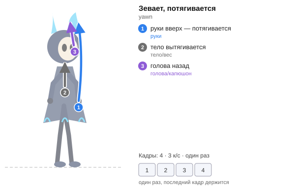

- **Что:** Ночью или перед сном.
- **Кадры:** 4, 3 к/с, цикл — один раз. Файлы: `yawn_1.png` … `yawn_4.png` + `yawn.png` (копия самого типичного кадра).
- **Опора:** ступни. **Референсы из пакета:** [`yawn`](../../ui/public/characters/default/yawn.webp), [`yawn_1`](../../ui/public/characters/default/yawn_1.webp) + `character-reference.png`.

**Фазы (идут в промпт кадра N):**
1. arms rise, mouth opens
2. full stretch, arms above the head
3. yawn ends, arms lower
4. neutral

**Движение частей (стрелки на схеме):**
- **1** (руки): руки вверх — потягивается
- **2** (тело/вес): тело вытягивается
- **3** (голова/капюшон): голова назад

**Промпт кадра N** (после вступления, к нему — общий хвост из §3):
```
Animation "yawn", frame N of 4: <phase N from the list above>. Same character, same scale and
the same anchor (ступни) as the reference; facing RIGHT. Only the parts listed in the phase move;
everything else stays exactly in place.
```

### Этап 18. Танцует — `dance`

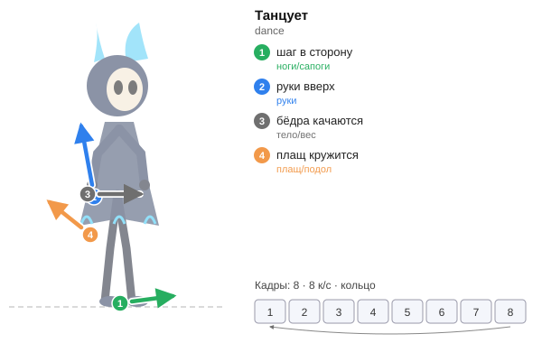

- **Что:** Под музыку плеера.
- **Кадры:** 8, 8 к/с, цикл — кольцо. Файлы: `dance_1.png` … `dance_8.png` + `dance.png` (копия самого типичного кадра).
- **Опора:** ступни. **Референсы из пакета:** [`dance_1`](../../ui/public/characters/default/dance_1.webp), [`dance_3`](../../ui/public/characters/default/dance_3.webp) + `character-reference.png`.

**Фазы (идут в промпт кадра N):**
1. step right, arms up
2. hip sway
3. spin quarter
4. step left
5. arms down
6. bounce
7. spin back
8. loop

**Движение частей (стрелки на схеме):**
- **1** (ноги/сапоги): шаг в сторону
- **2** (руки): руки вверх
- **3** (тело/вес): бёдра качаются
- **4** (плащ/подол): плащ кружится

**Промпт кадра N** (после вступления, к нему — общий хвост из §3):
```
Animation "dance", frame N of 8: <phase N from the list above>. Same character, same scale and
the same anchor (ступни) as the reference; facing RIGHT. Only the parts listed in the phase move;
everything else stays exactly in place.
```

### Этап 19. Тычет пальцем в кнопку — `poke`

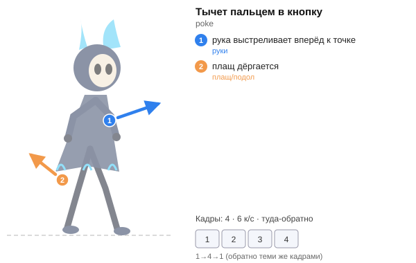

- **Что:** Подлетел к кнопке и тычет в неё.
- **Кадры:** 4, 6 к/с, цикл — туда-обратно. Файлы: `poke_1.png` … `poke_4.png` + `poke.png` (копия самого типичного кадра).
- **Опора:** кончик пальца (0,88; 0,42). **Референсы из пакета:** [`poke`](../../ui/public/characters/default/poke.webp), [`poke_1`](../../ui/public/characters/default/poke_1.webp) + `character-reference.png`.
- **Особо:** Кончик пальца — точка опоры, в кадре 2 строго на (0,88; 0,42).

**Фазы (идут в промпт кадра N):**
1. arm pulled back
2. finger touches the point
3. finger presses in, cloak jolts
4. relax

**Движение частей (стрелки на схеме):**
- **1** (руки): рука выстреливает вперёд к точке
- **2** (плащ/подол): плащ дёргается

**Промпт кадра N** (после вступления, к нему — общий хвост из §3):
```
Animation "poke", frame N of 4: <phase N from the list above>. Same character, same scale and
the same anchor (кончик пальца) as the reference; facing RIGHT. Only the parts listed in the phase move;
everything else stays exactly in place.
```

### Этап 20. Выглядывает из-за края — `peek`

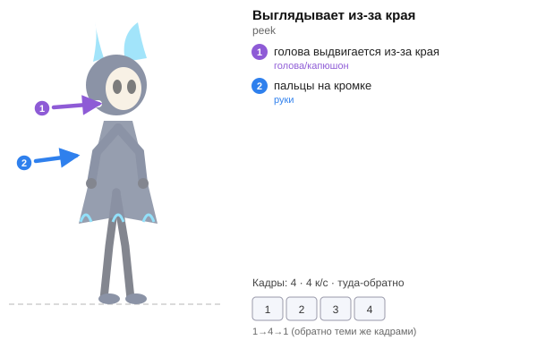

- **Что:** Выглядывает из-за края экрана/окна, видна голова и рука.
- **Кадры:** 4, 4 к/с, цикл — туда-обратно. Файлы: `peek_1.png` … `peek_4.png` + `peek.png` (копия самого типичного кадра).
- **Опора:** левый край кадра = край экрана. **Референсы из пакета:** [`peek`](../../ui/public/characters/default/peek.webp), [`peek_blink`](../../ui/public/characters/default/peek_blink.webp) + `character-reference.png`.
- **Особо:** Левый край холста — край экрана; всё левее не рисуется.

**Фазы (идут в промпт кадра N):**
1. only the hood edge visible
2. head peeks out, hand on the edge
3. head tilts curiously
4. pulls back slightly

**Движение частей (стрелки на схеме):**
- **1** (голова/капюшон): голова выдвигается из-за края
- **2** (руки): пальцы на кромке

**Промпт кадра N** (после вступления, к нему — общий хвост из §3):
```
Animation "peek", frame N of 4: <phase N from the list above>. Same character, same scale and
the same anchor (левый край кадра = край экрана) as the reference; facing RIGHT. Only the parts listed in the phase move;
everything else stays exactly in place.
```

## Часть III. Режимы

### Этап 21. Смотрит фильм с попкорном — `watch`

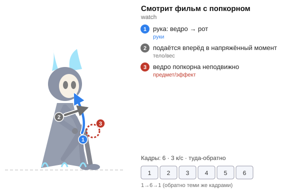

- **Что:** Сидит в углу экрана с ведёрком попкорна.
- **Кадры:** 6, 3 к/с, цикл — туда-обратно. Файлы: `watch_1.png` … `watch_6.png` + `watch.png` (копия самого типичного кадра).
- **Опора:** низ (0,5; 0,95). **Референсы из пакета:** [`watch`](../../ui/public/characters/default/watch.webp), [`watch_1`](../../ui/public/characters/default/watch_1.webp) + `character-reference.png`.

**Фазы (идут в промпт кадра N):**
1. sitting with a popcorn bucket, eyes on the screen
2. hand reaches into the bucket
3. hand to the mouth
4. chews
5. leans forward, tense moment
6. back, loop

**Движение частей (стрелки на схеме):**
- **1** (руки): рука: ведро → рот
- **2** (тело/вес): подаётся вперёд в напряжённый момент
- **3** (предмет/эффект): ведро попкорна неподвижно

**Промпт кадра N** (после вступления, к нему — общий хвост из §3):
```
Animation "watch", frame N of 6: <phase N from the list above>. Same character, same scale and
the same anchor (низ) as the reference; facing RIGHT. Only the parts listed in the phase move;
everything else stays exactly in place.
```

### Этап 22. Поёт — `sing`

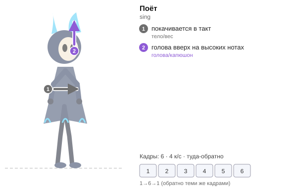

- **Что:** Радио: наушники на шее, поёт.
- **Кадры:** 6, 4 к/с, цикл — туда-обратно. Файлы: `sing_1.png` … `sing_6.png` + `sing.png` (копия самого типичного кадра).
- **Опора:** ступни. **Референсы из пакета:** [`sing`](../../ui/public/characters/default/sing.webp), [`sing_1`](../../ui/public/characters/default/sing_1.webp) + `character-reference.png`.

**Фазы (идут в промпт кадра N):**
1. mouth open, head up
2. sways right
3. hand to the chest
4. sways left
5. head down
6. loop

**Движение частей (стрелки на схеме):**
- **1** (тело/вес): покачивается в такт
- **2** (голова/капюшон): голова вверх на высоких нотах

**Промпт кадра N** (после вступления, к нему — общий хвост из §3):
```
Animation "sing", frame N of 6: <phase N from the list above>. Same character, same scale and
the same anchor (ступни) as the reference; facing RIGHT. Only the parts listed in the phase move;
everything else stays exactly in place.
```

### Этап 23. Сидит на музыкальном ящике — `jukebox`

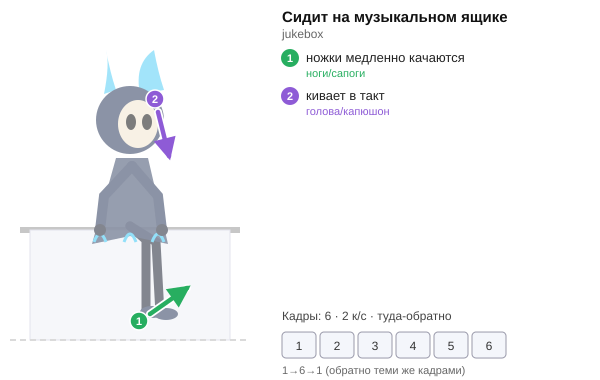

- **Что:** Сидит на ящике, медленно болтает ножками.
- **Кадры:** 6, 2 к/с, цикл — туда-обратно. Файлы: `jukebox_1.png` … `jukebox_6.png` + `jukebox.png` (копия самого типичного кадра).
- **Опора:** ступни (0,5; 0,97). **Референсы из пакета:** [`jukebox`](../../ui/public/characters/default/jukebox.webp), [`jukebox_1`](../../ui/public/characters/default/jukebox_1.webp) + `character-reference.png`.
- **Особо:** Очень спокойно: пользователь просил «не дёргаться».

**Фазы (идут в промпт кадра N):**
1. seated on the box
2. legs swing
3. head nods
4. legs swing back
5. head nods
6. loop

**Движение частей (стрелки на схеме):**
- **1** (ноги/сапоги): ножки медленно качаются
- **2** (голова/капюшон): кивает в такт

**Промпт кадра N** (после вступления, к нему — общий хвост из §3):
```
Animation "jukebox", frame N of 6: <phase N from the list above>. Same character, same scale and
the same anchor (ступни) as the reference; facing RIGHT. Only the parts listed in the phase move;
everything else stays exactly in place.
```

## Часть IV. Сцены настольного спутника

### Этап 24. Бежит за жуком — `chase`

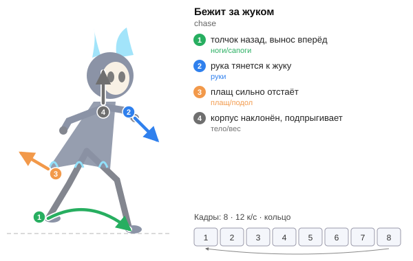

- **Что:** Азартный бег с наклоном вперёд, рука тянется поймать.
- **Кадры:** 8, 12 к/с, цикл — кольцо. Файлы: `chase_1.png` … `chase_8.png` + `chase.png` (копия самого типичного кадра).
- **Опора:** ступни. **Референсы из пакета:** [`chase_1`](../../ui/public/characters/default/chase_1.webp), [`chase_4`](../../ui/public/characters/default/chase_4.webp), [`chase_6`](../../ui/public/characters/default/chase_6.webp) + `character-reference.png`.
- **Особо:** Наклон тела одинаковый во всех кадрах.

**Фазы (идут в промпт кадра N):**
1. contact: front foot lands, body leaning forward
2. down: deepest, knees bent
3. push off: back leg extends
4. flight: both feet off the floor
5. contact other foot
6. down
7. push off
8. flight, loop

**Движение частей (стрелки на схеме):**
- **1** (ноги/сапоги): толчок назад, вынос вперёд
- **2** (руки): рука тянется к жуку
- **3** (плащ/подол): плащ сильно отстаёт
- **4** (тело/вес): корпус наклонён, подпрыгивает

**Промпт кадра N** (после вступления, к нему — общий хвост из §3):
```
Animation "chase", frame N of 8: <phase N from the list above>. Same character, same scale and
the same anchor (ступни) as the reference; facing RIGHT. Only the parts listed in the phase move;
everything else stays exactly in place.
```

### Этап 25. Тащит коробку на спине — `carry_box`

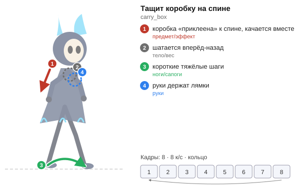

- **Что:** Скачивается файл: идёт, согнувшись под коробкой, шатается.
- **Кадры:** 8, 8 к/с, цикл — кольцо. Файлы: `carry_box_1.png` … `carry_box_8.png` + `carry_box.png` (копия самого типичного кадра).
- **Опора:** ступни. **Референсы из пакета:** [`carry_box_1`](../../ui/public/characters/default/carry_box_1.webp), [`carry_box_4`](../../ui/public/characters/default/carry_box_4.webp) + `character-reference.png`.
- **Особо:** Коробка без надписей и в одном месте относительно спины во всех кадрах.

**Фазы (идут в промпт кадра N):**
1. heavy step right foot, bent forward
2. sinks under the weight
3. passing
4. wobbles back
5. heavy step left foot
6. sinks
7. passing
8. wobbles forward, loop

**Движение частей (стрелки на схеме):**
- **1** (предмет/эффект): коробка «приклеена» к спине, качается вместе
- **2** (тело/вес): шатается вперёд-назад
- **3** (ноги/сапоги): короткие тяжёлые шаги
- **4** (руки): руки держат лямки

**Промпт кадра N** (после вступления, к нему — общий хвост из §3):
```
Animation "carry_box", frame N of 8: <phase N from the list above>. Same character, same scale and
the same anchor (ступни) as the reference; facing RIGHT. Only the parts listed in the phase move;
everything else stays exactly in place.
```

### Этап 26. Сдувает ветром (Win+D) — `blown`

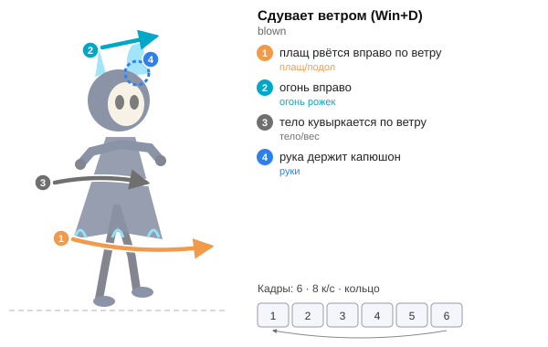

- **Что:** Ветер слева уносит персонажа, плащ и огонь рвутся вправо.
- **Кадры:** 6, 8 к/с, цикл — кольцо. Файлы: `blown_1.png` … `blown_6.png` + `blown.png` (копия самого типичного кадра).
- **Опора:** середина тела (0,5; 0,45). **Референсы из пакета:** [`blown_1`](../../ui/public/characters/default/blown_1.webp), [`blown_3`](../../ui/public/characters/default/blown_3.webp) + `character-reference.png`.
- **Особо:** Ветер всегда слева направо.

**Фазы (идут в промпт кадра N):**
1. lifted by the wind, holding the hood
2. tilted 20 degrees, cloak streaming right
3. spins a quarter turn
4. tumbles
5. grabs the hood again
6. tilted, loop

**Движение частей (стрелки на схеме):**
- **1** (плащ/подол): плащ рвётся вправо по ветру
- **2** (огонь рожек): огонь вправо
- **3** (тело/вес): тело кувыркается по ветру
- **4** (руки): рука держит капюшон

**Промпт кадра N** (после вступления, к нему — общий хвост из §3):
```
Animation "blown", frame N of 6: <phase N from the list above>. Same character, same scale and
the same anchor (середина тела) as the reference; facing RIGHT. Only the parts listed in the phase move;
everything else stays exactly in place.
```

### Этап 27. Стучит изнутри по стеклу — `knock`

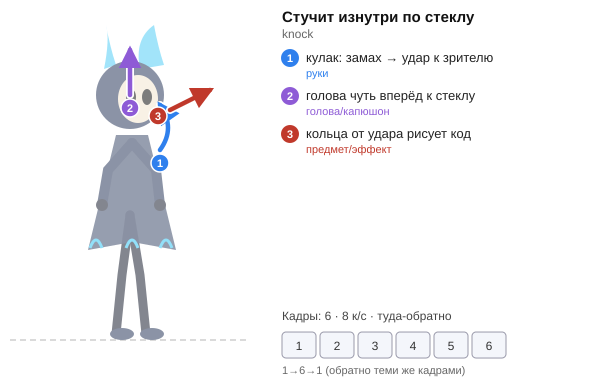

- **Что:** Лицом к зрителю, стучит кулачком в «стекло» экрана.
- **Кадры:** 6, 8 к/с, цикл — туда-обратно. Файлы: `knock_1.png` … `knock_6.png` + `knock.png` (копия самого типичного кадра).
- **Опора:** ступни. **Референсы из пакета:** [`knock`](../../ui/public/characters/default/knock.webp), [`knock_2`](../../ui/public/characters/default/knock_2.webp), [`knock_3`](../../ui/public/characters/default/knock_3.webp) + `character-reference.png`.
- **Особо:** Вид спереди (3/4 почти анфас); кулак в точке ≈ (0,7; 0,38).

**Фазы (идут в промпт кадра N):**
1. front view, fist raised near the viewer
2. fist pulled back
3. fist hits the glass, knuckles flatten
4. rebound
5. second knock
6. palm pressed flat on the glass, peeking

**Движение частей (стрелки на схеме):**
- **1** (руки): кулак: замах → удар к зрителю
- **2** (голова/капюшон): голова чуть вперёд к стеклу
- **3** (предмет/эффект): кольца от удара рисует код

**Промпт кадра N** (после вступления, к нему — общий хвост из §3):
```
Animation "knock", frame N of 6: <phase N from the list above>. Same character, same scale and
the same anchor (ступни) as the reference; facing RIGHT. Only the parts listed in the phase move;
everything else stays exactly in place.
```

### Этап 28. Ставит штамп «Сохранено!» — `stamp`

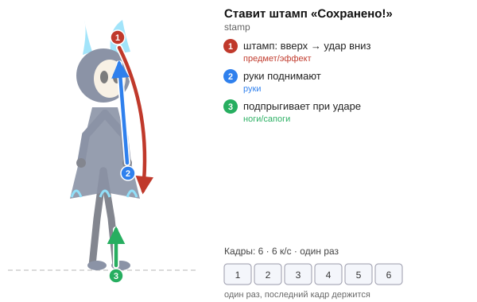

- **Что:** Ctrl+S: замах большим штампом и удар.
- **Кадры:** 6, 6 к/с, цикл — один раз. Файлы: `stamp_1.png` … `stamp_6.png` + `stamp.png` (копия самого типичного кадра).
- **Опора:** ступни. **Референсы из пакета:** [`stamp`](../../ui/public/characters/default/stamp.webp), [`stamp_2`](../../ui/public/characters/default/stamp_2.webp), [`stamp_3`](../../ui/public/characters/default/stamp_3.webp) + `character-reference.png`.
- **Особо:** На штампе ни одной буквы; оттиск рисует код.

**Фазы (идут в промпт кадра N):**
1. lifts the big stamp with both hands
2. stamp high above the head
3. swings down
4. slam at waist height, little jump
5. lifts the stamp
6. proud, hand on hip

**Движение частей (стрелки на схеме):**
- **1** (предмет/эффект): штамп: вверх → удар вниз
- **2** (руки): руки поднимают
- **3** (ноги/сапоги): подпрыгивает при ударе

**Промпт кадра N** (после вступления, к нему — общий хвост из §3):
```
Animation "stamp", frame N of 6: <phase N from the list above>. Same character, same scale and
the same anchor (ступни) as the reference; facing RIGHT. Only the parts listed in the phase move;
everything else stays exactly in place.
```

### Этап 29. Ловит бумажку — `hug_paper`

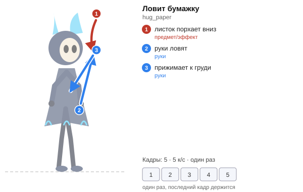

- **Что:** Скопировали текст: ловит падающий листок и прижимает к груди.
- **Кадры:** 5, 5 к/с, цикл — один раз. Файлы: `hug_paper_1.png` … `hug_paper_5.png` + `hug_paper.png` (копия самого типичного кадра).
- **Опора:** ступни. **Референсы из пакета:** [`hug_paper_1`](../../ui/public/characters/default/hug_paper_1.webp), [`hug_paper`](../../ui/public/characters/default/hug_paper.webp) + `character-reference.png`.
- **Особо:** На листке серые полоски вместо текста.

**Фазы (идут в промпт кадра N):**
1. looks up, arms up
2. catches a fluttering paper
3. brings it down
4. hugs it to the chest
5. eyes closed, happy

**Движение частей (стрелки на схеме):**
- **1** (предмет/эффект): листок порхает вниз
- **2** (руки): руки ловят
- **3** (руки): прижимает к груди

**Промпт кадра N** (после вступления, к нему — общий хвост из §3):
```
Animation "hug_paper", frame N of 5: <phase N from the list above>. Same character, same scale and
the same anchor (ступни) as the reference; facing RIGHT. Only the parts listed in the phase move;
everything else stays exactly in place.
```

### Этап 30. Пугается вспышки скриншота — `flinch`

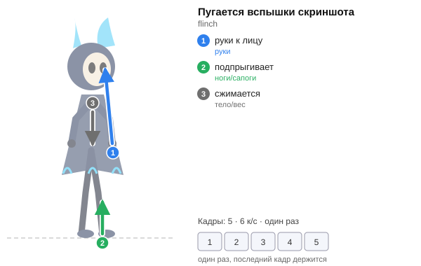

- **Что:** Вспышка: зажмурился, закрылся руками, подпрыгнул.
- **Кадры:** 5, 6 к/с, цикл — один раз. Файлы: `flinch_1.png` … `flinch_5.png` + `flinch.png` (копия самого типичного кадра).
- **Опора:** ступни. **Референсы из пакета:** [`flinch`](../../ui/public/characters/default/flinch.webp), [`flinch_1`](../../ui/public/characters/default/flinch_1.webp) + `character-reference.png`.
- **Особо:** Вспышку рисует код.

**Фазы (идут в промпт кадра N):**
1. startled jump, eyes squeezed
2. hands cover the mask
3. peeks through fingers
4. hands lower
5. blinks, small wobble

**Движение частей (стрелки на схеме):**
- **1** (руки): руки к лицу
- **2** (ноги/сапоги): подпрыгивает
- **3** (тело/вес): сжимается

**Промпт кадра N** (после вступления, к нему — общий хвост из §3):
```
Animation "flinch", frame N of 5: <phase N from the list above>. Same character, same scale and
the same anchor (ступни) as the reference; facing RIGHT. Only the parts listed in the phase move;
everything else stays exactly in place.
```

### Этап 31. Спотыкается и падает — `trip`

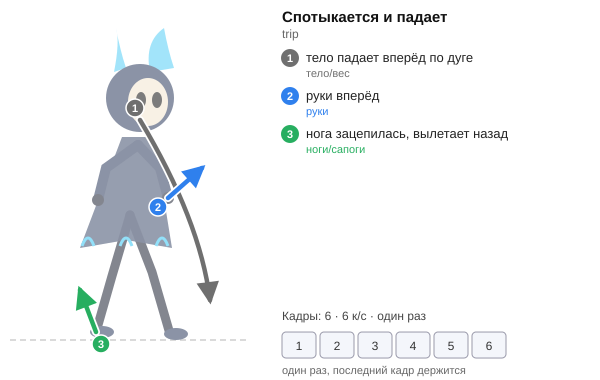

- **Что:** Шёл, зацепился носком, упал, сел, потирая капюшон.
- **Кадры:** 6, 6 к/с, цикл — один раз. Файлы: `trip_1.png` … `trip_6.png` + `trip.png` (копия самого типичного кадра).
- **Опора:** ступни (лёжа — низ 0,97). **Референсы из пакета:** [`trip_1`](../../ui/public/characters/default/trip_1.webp), [`trip_3`](../../ui/public/characters/default/trip_3.webp), [`trip_4`](../../ui/public/characters/default/trip_4.webp) + `character-reference.png`.
- **Особо:** Пол на одной линии во всех кадрах.

**Фазы (идут в промпт кадра N):**
1. toe catches, arms flail
2. tilts forward
3. falling
4. lying face down, legs up
5. sits up
6. rubs the hood, embarrassed

**Движение частей (стрелки на схеме):**
- **1** (тело/вес): тело падает вперёд по дуге
- **2** (руки): руки вперёд
- **3** (ноги/сапоги): нога зацепилась, вылетает назад

**Промпт кадра N** (после вступления, к нему — общий хвост из §3):
```
Animation "trip", frame N of 6: <phase N from the list above>. Same character, same scale and
the same anchor (ступни) as the reference; facing RIGHT. Only the parts listed in the phase move;
everything else stays exactly in place.
```

### Этап 32. Вертит находку — `inspect`

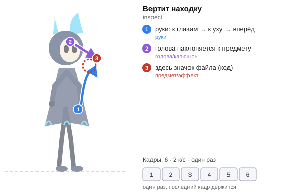

- **Что:** Держит маленький предмет (значок файла рисует код) у груди и разглядывает.
- **Кадры:** 6, 2 к/с, цикл — один раз. Файлы: `inspect_1.png` … `inspect_6.png` + `inspect.png` (копия самого типичного кадра).
- **Опора:** ступни. **Референсы из пакета:** [`inspect_1`](../../ui/public/characters/default/inspect_1.webp), [`inspect_3`](../../ui/public/characters/default/inspect_3.webp) + `character-reference.png`.
- **Особо:** Лицо любопытное, а не хитрое. Руки пустые — предмет рисует код в точке ≈ (0,68; 0,42).

**Фазы (идут в промпт кадра N):**
1. holds something small up to the eyes, curious
2. turns it in the fingers
3. shakes it next to the ear
4. sniffs it
5. holds at arm's length, thinking
6. nods

**Движение частей (стрелки на схеме):**
- **1** (руки): руки: к глазам → к уху → вперёд
- **2** (голова/капюшон): голова наклоняется к предмету
- **3** (предмет/эффект): здесь значок файла (код)

**Промпт кадра N** (после вступления, к нему — общий хвост из §3):
```
Animation "inspect", frame N of 6: <phase N from the list above>. Same character, same scale and
the same anchor (ступни) as the reference; facing RIGHT. Only the parts listed in the phase move;
everything else stays exactly in place.
```

### Этап 33. Прячет в карман — `pocket`

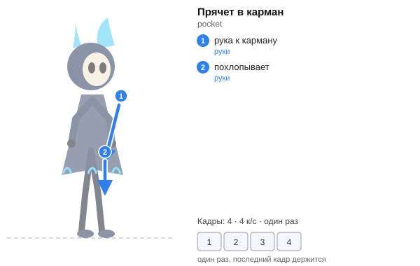

- **Что:** Открывает маленький карман на плаще и прячет туда вещь.
- **Кадры:** 4, 4 к/с, цикл — один раз. Файлы: `pocket_1.png` … `pocket_4.png` + `pocket.png` (копия самого типичного кадра).
- **Опора:** ступни. **Референсы из пакета:** [`pocket_1`](../../ui/public/characters/default/pocket_1.webp), [`pocket_3`](../../ui/public/characters/default/pocket_3.webp) + `character-reference.png`.
- **Особо:** Карман аккуратный и небольшой, после сцены не оттопыривается (кадры с сумкой убраны).

**Фазы (идут в промпт кадра N):**
1. opens a small pocket at the right hip
2. tucks something small inside
3. pats the pocket
4. satisfied

**Движение частей (стрелки на схеме):**
- **1** (руки): рука к карману
- **2** (руки): похлопывает

**Промпт кадра N** (после вступления, к нему — общий хвост из §3):
```
Animation "pocket", frame N of 4: <phase N from the list above>. Same character, same scale and
the same anchor (ступни) as the reference; facing RIGHT. Only the parts listed in the phase move;
everything else stays exactly in place.
```

### Этап 34. Кладёт обратно — `put_back`

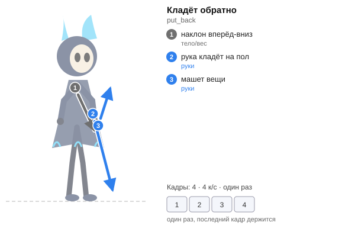

- **Что:** Наклоняется и аккуратно кладёт вещь.
- **Кадры:** 4, 4 к/с, цикл — один раз. Файлы: `put_back_1.png` … `put_back_4.png` + `put_back.png` (копия самого типичного кадра).
- **Опора:** ступни. **Референсы из пакета:** [`put_back_1`](../../ui/public/characters/default/put_back_1.webp), [`put_back_2`](../../ui/public/characters/default/put_back_2.webp) + `character-reference.png`.

**Фазы (идут в промпт кадра N):**
1. bends down
2. places it carefully
3. stands up
4. small wave goodbye

**Движение частей (стрелки на схеме):**
- **1** (тело/вес): наклон вперёд-вниз
- **2** (руки): рука кладёт на пол
- **3** (руки): машет вещи

**Промпт кадра N** (после вступления, к нему — общий хвост из §3):
```
Animation "put_back", frame N of 4: <phase N from the list above>. Same character, same scale and
the same anchor (ступни) as the reference; facing RIGHT. Only the parts listed in the phase move;
everything else stays exactly in place.
```

### Этап 35. Выбрасывает и отряхивает руки — `throw`

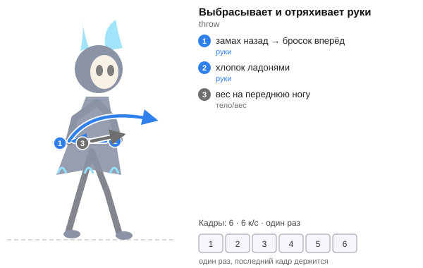

- **Что:** Бросок вправо в нарисованную корзину, затем хлопает ладонями. Кадры 1–3 — `throw_1…3`, 4–6 — `dust_hands_1…3`.
- **Кадры:** 6, 6 к/с, цикл — один раз. Файлы: `throw_1.png` … `throw_6.png` + `throw.png` (копия самого типичного кадра).
- **Опора:** ступни. **Референсы из пакета:** [`throw_1`](../../ui/public/characters/default/throw_1.webp), [`throw_2`](../../ui/public/characters/default/throw_2.webp), [`dust_hands_1`](../../ui/public/characters/default/dust_hands_1.webp) + `character-reference.png`.
- **Особо:** Корзину рисует код справа на уровне пола.

**Фазы (идут в промпт кадра N):**
1. wind-up, arm back
2. throw forward to the right
3. follow-through, hand open
4. turns to the front
5. claps hands together
6. hands apart, satisfied

**Движение частей (стрелки на схеме):**
- **1** (руки): замах назад → бросок вперёд
- **2** (руки): хлопок ладонями
- **3** (тело/вес): вес на переднюю ногу

**Промпт кадра N** (после вступления, к нему — общий хвост из §3):
```
Animation "throw", frame N of 6: <phase N from the list above>. Same character, same scale and
the same anchor (ступни) as the reference; facing RIGHT. Only the parts listed in the phase move;
everything else stays exactly in place.
```

### Этап 36. Читает книжку — `read`

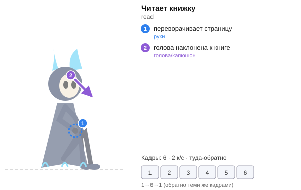

- **Что:** Сидит и листает крошечную книжку.
- **Кадры:** 6, 2 к/с, цикл — туда-обратно. Файлы: `read_1.png` … `read_6.png` + `read.png` (копия самого типичного кадра).
- **Опора:** низ (0,5; 0,95). **Референсы из пакета:** [`read_1`](../../ui/public/characters/default/read_1.webp), [`read_2`](../../ui/public/characters/default/read_2.webp), [`read_3`](../../ui/public/characters/default/read_3.webp) + `character-reference.png`.
- **Особо:** Книжка крупнее, чем в прошлой генерации — иначе её не видно.

**Фазы (идут в промпт кадра N):**
1. reading
2. eyes move along the line
3. turns a page (page lifted)
4. page down
5. small laugh
6. loop

**Движение частей (стрелки на схеме):**
- **1** (руки): переворачивает страницу
- **2** (голова/капюшон): голова наклонена к книге

**Промпт кадра N** (после вступления, к нему — общий хвост из §3):
```
Animation "read", frame N of 6: <phase N from the list above>. Same character, same scale and
the same anchor (низ) as the reference; facing RIGHT. Only the parts listed in the phase move;
everything else stays exactly in place.
```

### Этап 37. Рисует — `draw`

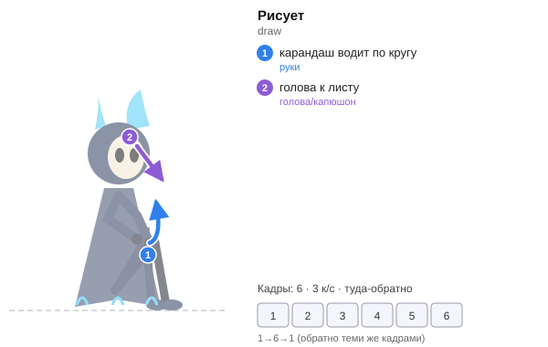

- **Что:** Сидит, рисует карандашом на листке.
- **Кадры:** 6, 3 к/с, цикл — туда-обратно. Файлы: `draw_1.png` … `draw_6.png` + `draw.png` (копия самого типичного кадра).
- **Опора:** низ (0,5; 0,95). **Референсы из пакета:** [`draw_1`](../../ui/public/characters/default/draw_1.webp), [`draw_3`](../../ui/public/characters/default/draw_3.webp) + `character-reference.png`.

**Фазы (идут в промпт кадра N):**
1. pencil on paper
2. draws a stroke
3. another stroke
4. tongue out concentrating
5. holds the drawing up
6. loop

**Движение частей (стрелки на схеме):**
- **1** (руки): карандаш водит по кругу
- **2** (голова/капюшон): голова к листу

**Промпт кадра N** (после вступления, к нему — общий хвост из §3):
```
Animation "draw", frame N of 6: <phase N from the list above>. Same character, same scale and
the same anchor (низ) as the reference; facing RIGHT. Only the parts listed in the phase move;
everything else stays exactly in place.
```

### Этап 38. Жонглирует — `juggle`

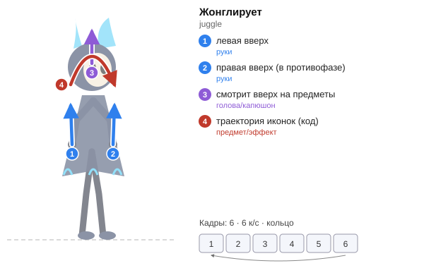

- **Что:** Подбрасывает невидимые предметы (иконки рисует код).
- **Кадры:** 6, 6 к/с, цикл — кольцо. Файлы: `juggle_1.png` … `juggle_6.png` + `juggle.png` (копия самого типичного кадра).
- **Опора:** ступни. **Референсы из пакета:** [`juggle_1`](../../ui/public/characters/default/juggle_1.webp), [`juggle_3`](../../ui/public/characters/default/juggle_3.webp) + `character-reference.png`.
- **Особо:** Ладони пустые.

**Фазы (идут в промпт кадра N):**
1. left hand up
2. both hands at the chest
3. right hand up
4. both hands catching
5. left hand up
6. loop

**Движение частей (стрелки на схеме):**
- **1** (руки): левая вверх
- **2** (руки): правая вверх (в противофазе)
- **3** (голова/капюшон): смотрит вверх на предметы
- **4** (предмет/эффект): траектория иконок (код)

**Промпт кадра N** (после вступления, к нему — общий хвост из §3):
```
Animation "juggle", frame N of 6: <phase N from the list above>. Same character, same scale and
the same anchor (ступни) as the reference; facing RIGHT. Only the parts listed in the phase move;
everything else stays exactly in place.
```

### Этап 39. Строит — `build`

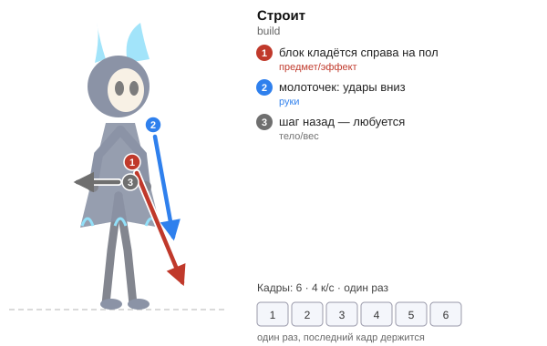

- **Что:** Несёт бумажный блок, кладёт, стучит молоточком, любуется.
- **Кадры:** 6, 4 к/с, цикл — один раз. Файлы: `build_1.png` … `build_6.png` + `build.png` (копия самого типичного кадра).
- **Опора:** ступни. **Референсы из пакета:** [`build_1`](../../ui/public/characters/default/build_1.webp), [`build_3`](../../ui/public/characters/default/build_3.webp) + `character-reference.png`.
- **Особо:** Блоки постройки рисует код; в кадре только блок в руках и молоточек.

**Фазы (идут в промпт кадра N):**
1. carries a small paper block
2. places it to the right
3. picks up a tiny mallet
4. taps
5. taps again
6. steps back, hands on hips

**Движение частей (стрелки на схеме):**
- **1** (предмет/эффект): блок кладётся справа на пол
- **2** (руки): молоточек: удары вниз
- **3** (тело/вес): шаг назад — любуется

**Промпт кадра N** (после вступления, к нему — общий хвост из §3):
```
Animation "build", frame N of 6: <phase N from the list above>. Same character, same scale and
the same anchor (ступни) as the reference; facing RIGHT. Only the parts listed in the phase move;
everything else stays exactly in place.
```

### Этап 40. Прилепляет записку — `note_put`

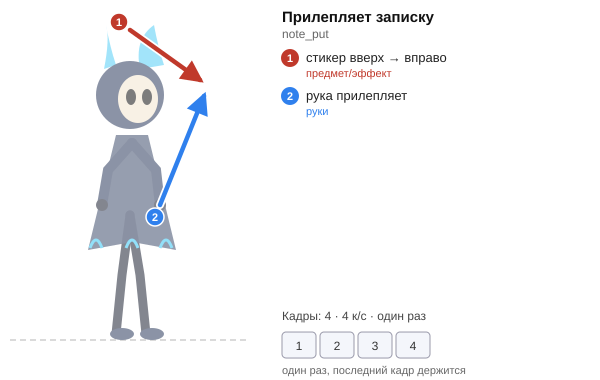

- **Что:** Поднимает жёлтый стикер и прилепляет его справа.
- **Кадры:** 4, 4 к/с, цикл — один раз. Файлы: `note_put_1.png` … `note_put_4.png` + `note_put.png` (копия самого типичного кадра).
- **Опора:** ступни. **Референсы из пакета:** [`note_put_1`](../../ui/public/characters/default/note_put_1.webp), [`note_put_2`](../../ui/public/characters/default/note_put_2.webp) + `character-reference.png`.
- **Особо:** Стикер без текста; точка ≈ (0,78; 0,3).

**Фазы (идут в промпт кадра N):**
1. holds a yellow sticky note above the head
2. reaches to the right
3. sticks it, presses
4. points at it, cheerful

**Движение частей (стрелки на схеме):**
- **1** (предмет/эффект): стикер вверх → вправо
- **2** (руки): рука прилепляет

**Промпт кадра N** (после вступления, к нему — общий хвост из §3):
```
Animation "note_put", frame N of 4: <phase N from the list above>. Same character, same scale and
the same anchor (ступни) as the reference; facing RIGHT. Only the parts listed in the phase move;
everything else stays exactly in place.
```

### Этап 41. Забирает записку — `note_take`

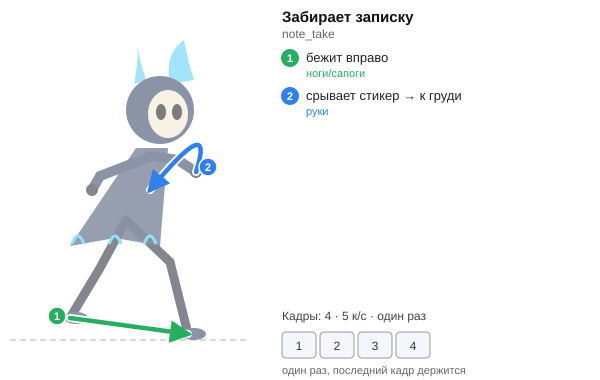

- **Что:** Подбегает, отлепляет стикер, прижимает к груди, машет.
- **Кадры:** 4, 5 к/с, цикл — один раз. Файлы: `note_take_1.png` … `note_take_4.png` + `note_take.png` (копия самого типичного кадра).
- **Опора:** ступни. **Референсы из пакета:** [`note_take_1`](../../ui/public/characters/default/note_take_1.webp), [`note_take_3`](../../ui/public/characters/default/note_take_3.webp) + `character-reference.png`.

**Фазы (идут в промпт кадра N):**
1. runs to the right
2. peels the note off
3. holds it to the chest
4. waves

**Движение частей (стрелки на схеме):**
- **1** (ноги/сапоги): бежит вправо
- **2** (руки): срывает стикер → к груди

**Промпт кадра N** (после вступления, к нему — общий хвост из §3):
```
Animation "note_take", frame N of 4: <phase N from the list above>. Same character, same scale and
the same anchor (ступни) as the reference; facing RIGHT. Only the parts listed in the phase move;
everything else stays exactly in place.
```

---

## Принято (2026-11-19, версия 0.3.0)

Сдано GPT: 41 этап, 228 номерных кадров (`…\outputs\anim-stages\`, отчёт — `QA.md` там же). Подключено всё.

- **Масштаб.** GPT привёл кадры к одному масштабу: рост стойки 1130 px на холсте 1024×1536 (0,77 от прежнего
  `stand.png`). Подгонка — один общий множитель `753 / 1130` для всех кадров, без покадровых поправок; опора позы
  переносится туда, где её ждёт код (`ANCHORS`). WebP q90, ширина 800, высота 768 + место для высоких кадров.
- **Высокие кадры.** Лишнее место — со стороны, дальней от опоры: у стоящих сверху, у подвешенных (`held`,
  `hang_side`, опора выше середины кадра) — снизу. Так же считает код (`placement.ts`, `growsDown`); «обычная»
  высота — из роста персонажа, а не из кадра `stand`.
- **Опоры, изменённые в коде:** `float` 0,6 → 0,55 и `blown` 0,45 → 0,5 — иначе кадры не влезали ни сверху, ни снизу.
- **Частоты** — по таблице этапов (`LOOP_FPS`, `SCENE_FPS`); кольцом теперь ещё `dizzy` и `juggle`; `yawn` —
  один раз за эмоцию.
- **Базовые кадры** (`<id>.png` — копия одного из кадров) в одноразовых сценах в порядок не вставляются
  (у `stamp` база — кадр удара); нужны, только если номерных нет.
- **Не взяты:** `throw_4…6` — копии `dust_hands_1…3` (хлопок проигрался бы дважды).
- **Убраны старые варианты рта и моргания** `laydown_talk*`, `laydown_blink*`, `sit_edge_talk*`, `sit_edge_blink*`:
  нарисованы в другой позе, при речи персонаж прыгал бы между позами. Рот и моргание стоя (`stand_talk*`,
  `stand_blink*`) остались — поза почти та же. Новые варианты рта для «сидит на краю» и «лежит» — отдельным этапом.
- **Остались вопросы из QA GPT:** `note_take_2` (отлепление стикера читается слабо), плавность `read`, `draw`,
  `inspect` (наклон головы и высота рожек между кадрами), смена наклона огня в `float` 2→3.

## Точная подгонка размера (2026-11-19, версия 0.3.1)

Жалоба пользователя: перепады роста внутри анимаций, сильнее всего — в сидячих. Замер подтвердил: у GPT внутри
этапа кадры отличались до 10–16 % (`sit_edge` 2–6 мельче на 7 %, `perch_corner` 3/5/6 — на 10–13 %, `watch` 2–6 —
на 11 %, `read_2` — 13 %, `draw_3/4` — 16 %, `hang_side`, `carry_box`).

- **Внутри этапа** — сопоставление головы (капюшон + маска, без огня) по шаблону с первым кадром этапа:
  нормированная кросс-корреляция через FFT, перебор масштаба 0,84–1,16 с шагом 1 %. Кадр, где совпадение
  неуверенное (< 0,9 или на краю диапазона), — по высоте маски относительно первого кадра.
- **Уровень этапа к стойке** — у прямо стоящих по росту (подошвы → верх капюшона без огня), у остальных — медиана
  мерок: шаблон, маска, глаза (если выражение обычное). Мерки по отдельности ненадёжны между этапами: анфас шире,
  прищур/закрытые глаза меньше, кремовые предметы (книга, бумага, кант кармана) прилипают к маске.
- **Итог** (маска, разброс внутри этапа): `sit_edge` 1,9 %, `perch_corner` 1,9 %, `sit_corner` 1,9 %, `watch` 3,9 %,
  `stand` 1,9 % — шум замера. Обрезанных кадров нет.
- **Убраны старые переходные кадры** `*_to_*` (9 шт.): нарисованы под прежние позы и рост (скачок на стыке поз),
  у `stand_to_held_1` обрезаны сапоги. Без них код плавно растворяет одну позу в другую. Новые переходы — отдельным
  этапом.
